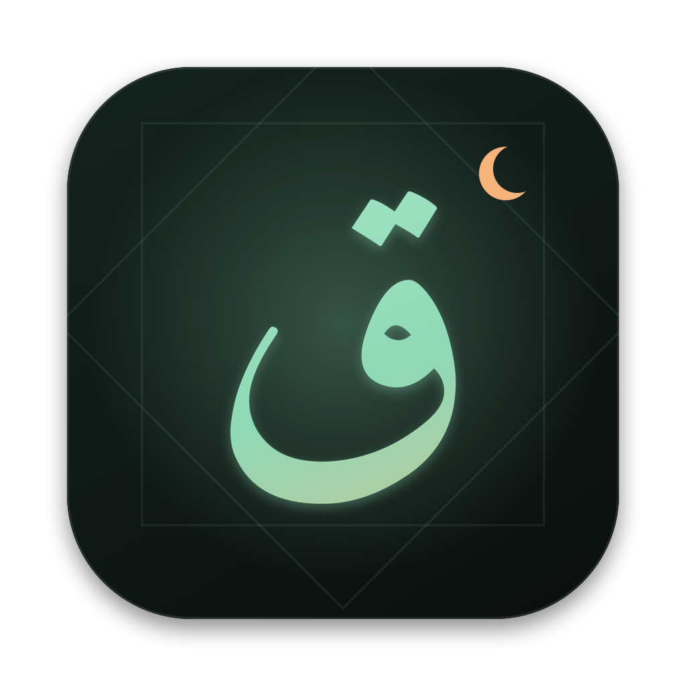

<p align="center"></p>

# Coran pour Mac

Une app **gratuite**, rapide et **native** pour lire, écouter et apprendre le Coran sur Mac. Tout reste sur ton Mac, sans compte ni publicité.

**[Site de présentation](https://vf501d8k0u-coran.vercel.app)** · **[Télécharger](https://github.com/gaissepro/coran-mac/releases/latest/download/Coran-macOS-AppleSilicon.zip)**

> English: a free, native macOS app to read, listen to and learn the Quran: Arabic (Uthmani) with French translations, synchronized recitation, context notes, a Duolingo-style Arabic course, voice recitation check and stats. Apple Silicon, macOS 14+.

## Fonctions

- **Lecture soignée** : les 114 sourates en arabe vocalisé (police Amiri Quran) avec traduction française (Hamidullah ou Montada), thèmes sombre, sépia et clair, taille réglable.
- **Récitation qui suit le texte** : 5 récitants, verset surligné et mots colorés, répétition d'un verset pour mémoriser, vitesse réglable.
- **Contexte** : nom français, lieu et ordre de révélation, contexte de chaque sourate, 570 notes par verset et un glossaire de mots difficiles à traduire (taqwa, jihad, fitna, « daraba » en 4:34…).
- **Apprendre l'arabe** : alphabet, voyelles, 40 mots du Coran, lecture à voix haute, remise en ordre de versets. XP, série de jours, objectif quotidien, badges, révision pour retenir.
- **Je récite** : le micro compare ta récitation au texte, mot par mot.
- **Stats** : temps de lecture, d'écoute et d'apprentissage, régularité sur 12 semaines.
- **Hadiths** : 40 de Nawawi et 40 hadiths qudsi.
- **Recherche ⌘K** : une sourate (« bakara »), une référence (« 2:255 »), un mot en français ou en arabe.

## Installer

1. Télécharge le zip depuis les [Releases](https://github.com/gaissepro/coran-mac/releases/latest), décompresse et glisse **Coran** dans **Applications**.
2. Premier lancement : l'app n'est pas signée par Apple. Fais **clic droit > Ouvrir**, ou dans Terminal :
   ```bash
   xattr -cr /Applications/Coran.app
   ```
3. Prérequis : Mac avec puce Apple (M1 ou plus récent), macOS 14 ou plus.

L'audio est lu en streaming (internet requis la première fois, puis mis en cache). La reconnaissance vocale de « Je récite » passe par les serveurs d'Apple.

## Compiler

Il suffit des Command Line Tools (pas besoin de Xcode) :

```bash
git clone https://github.com/gaissepro/coran-mac && cd coran-mac
./build.sh            # produit build/Coran.app
open build/Coran.app
```

Pour régénérer les données : `python3 scripts/fetch_data.py`. Notes d'architecture dans [AGENTS.md](AGENTS.md).

## Contenu et sources

Textes, traductions, audios et polices appartiennent à leurs auteurs : voir [DATA_SOURCES.md](DATA_SOURCES.md). Le contexte de révélation et le glossaire ont été rédigés avec l'aide d'une IA : ce sont des **résumés généraux**, à relire avec un savant, qui ne remplacent pas un tafsir. Les notes Montada reflètent le point de vue de leurs auteurs.

## Remerciements

Interface inspirée de [Bible](https://github.com/michaelshimeles/bible) de Rasmic. Merci à Tanzil, alquran.cloud, QuranEnc/Montada, Quran.com, everyayah.com et fawazahmed0.

## Licence

Code : MIT. Contenus : voir DATA_SOURCES.md.
